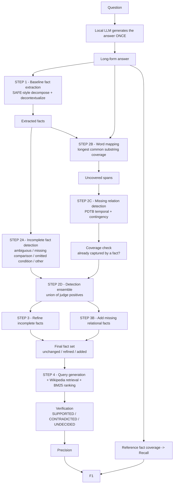

# VERIFACT-Lite

**A resource-constrained reimplementation of the core VERIFACT methodology using open-source, locally hosted models.**

This repository reimplements the central VERIFACT fact-refinement mechanism under constrained hardware using open-source local models. It does **not** reproduce the paper's experiments, models, benchmark or reported numbers.

## Paper

> **VERIFACT: Enhancing Long-Form Factuality Evaluation with Refined Fact Extraction and Reference Facts**
> Xin Liu, Lechen Zhang, Sheza Munir, Yiyang Gu, Lu Wang — University of Michigan
> EMNLP 2025 (main conference), pages 17908–17925. DOI: `10.18653/v1/2025.emnlp-main.905`
> arXiv: [2505.09701](https://arxiv.org/abs/2505.09701)

Official implementation: **https://github.com/launchnlp/VeriFact**

The paper is the authoritative source for the methodology here. The official repository was read as an implementation reference: the word-mapping algorithm, the two-stage missing-relation check (detect the relation, then confirm no existing fact covers it), the SAFE-style decomposition few-shot prompt, the decontextualization prompt, and the markdown-code-block output convention all follow it.

## Scope and honest claims

| Claim | Status |
|---|---|
| Reproduces the paper's exact results | **No** |
| Reproduces the core methodology (detect incomplete facts, detect missing relations, refine, verify) | **Yes** |
| Uses the paper's models (GPT-4o, Llama 3.3-70B, Qwen 2.5-32B) | **No** — two 3B local judges |
| Uses FACTRBENCH (1,096 prompts) | **No** — a 12-question mini benchmark built for this repo |
| Uses Google Search / Serper for evidence | **No** — free Wikipedia retrieval |
| Requires a paid API key | **No** |
| Runs locally on one consumer GPU | **Yes** |

The scientific idea being reproduced: *existing long-form factuality pipelines extract incomplete claims and drop important inter-sentence relations; detecting and repairing those problems before verification changes the resulting factuality judgements.*

## What the paper does, and what this repo does instead

The paper's detection stage is an **ensemble of three LLM judges** — GPT-4o, Llama 3.3-70B and Qwen 2.5-32B — whose **positive detections are unioned** to prioritise recall (reported detection recall: 0.89 for completeness labelling, 0.85 for missing facts). Those three judges are the detection ensemble. They are *not* the twelve models that the paper separately benchmarks on FACTRBENCH; the twelve benchmarked models are the systems under evaluation, and this repo does not benchmark them.

VERIFACT-Lite replaces the three judges with locally runnable open models (Qwen2.5-3B-Instruct and Llama-3.2-3B-Instruct, Q4_K_M, run sequentially) and keeps the union rule. The architecture supports any number of judges; with one judge configured it runs single-judge.

## Architecture



Both pipelines consume **the same generated answer**, so baseline and VERIFACT-Lite differ only in whether the refinement stage runs.

```
                 Question
                     |
      Local LLM generates the answer ONCE
                     |
         +-----------+-----------+
         |                       |
     Baseline              VERIFACT-Lite
         |                       |
   fact extraction         fact extraction
         |                       |
    verification             detection
                                 |
                             refinement
                                 |
                             verification
```

## Installation

```bash
git clone <this repo>
cd Verifact-Lite
python -m pip install -r requirements.txt
```

Optional: better sentence splitting (a regex fallback is used if this is skipped).

```bash
python -c "import nltk; nltk.download('punkt_tab')"
```

## Local model setup

Default backend is **Ollama**, which runs llama.cpp internally and offloads to the GPU automatically. Install Ollama from https://ollama.com, then:

```bash
ollama serve
```

```bash
ollama pull qwen2.5:3b-instruct-q4_K_M
```

```bash
ollama pull llama3.2:3b-instruct-q4_K_M
```

### Using llama.cpp directly instead

`config.yaml` supports two other backends, so no model name is hard-coded anywhere in the source.

`llama_cpp_server` — start llama.cpp's OpenAI-compatible server and point the config at it:

```bash
llama-server -m models/qwen2.5-3b-instruct-q4_k_m.gguf --port 8080 -c 8192 -ngl 99
```

Then set `model.backend: llama_cpp_server` (and the same for each judge) in `config.yaml`.

`llama_cpp_python` — in-process bindings over a GGUF file:

```bash
python -m pip install llama-cpp-python
```

Then set `model.backend: llama_cpp_python` and `backends.llama_cpp_python.model_path`.

### Configuration

Everything is driven by `config.yaml`:

```yaml
model:
  name: Qwen2.5-3B-Instruct
  backend: ollama
  model_id: qwen2.5:3b-instruct-q4_K_M
  quantization: Q4_K_M
  temperature: 0.1
  max_tokens: 2048

judges:
  - alias: qwen
    model_id: qwen2.5:3b-instruct-q4_K_M
  - alias: llama
    model_id: llama3.2:3b-instruct-q4_K_M

ensemble:
  strategy: union          # union | majority | weighted
```

Dropping the second judge from the list is all that is needed to run single-judge. Adding a third (Gemma, Mistral, …) needs one more list entry.

## Running

```bash
python -m experiments.run_baseline
```

```bash
python -m experiments.run_verifact
```

```bash
python -m experiments.run_ablation
```

```bash
python -m experiments.compare
```

```bash
python demo.py
```

The ensemble rule can be overridden per run. Union is the paper's rule; a majority run reuses the cached judge decisions, so it costs almost nothing after the union run and writes `outputs/ablation_majority.*`, which `compare.py` then reports as an extra table:

```bash
python -m experiments.run_ablation --ensemble majority
```

`demo.py` walks one example through every stage and prints the intermediate output; `python demo.py --qid Q03` runs a question from the challenge set, `--no-verify` stops before retrieval.

Optional UI:

```bash
streamlit run app.py
```

Tests:

```bash
python -m pytest tests -q
```

### Notes on running

* The first run of each question is slow (a 3B model does hundreds of calls per answer). Every LLM call is cached under `cache/` as `hash(model + prompt + parameters)`, so re-running is fast and repeatable.
* Every Wikipedia response is cached under `data/evidence/`. Setting `retrieval.offline_only: true` forbids the network and runs purely from that cache.
* `outputs/answers.json` stores the generated answers. All later runs reuse it, which is what guarantees baseline and VERIFACT-Lite see byte-identical answers. Delete it to regenerate.
* `--limit N` runs only the first N questions.
* **Run one experiment process at a time.** Two concurrent runs fight over the GPU and each model swap costs ~20 s, which is far more than the inference itself.
* Two 3B Q4_K_M judges do not fit in 4 GB of VRAM together. The pipeline drives one judge at a time over the whole fact list and then releases its weights (`run.unload_between_judges`), so each question pays a couple of model loads instead of one per call. Set it to `false` if your GPU holds every judge at once.

## Results

<!-- RESULTS:START -->

_Not generated yet. Run the four commands under **Running** and the measured numbers are inserted here automatically._

<!-- RESULTS:END -->

Generated artefacts:

```
outputs/baseline.json                      per-question baseline run
outputs/verifact.json                      per-question VERIFACT-Lite run
outputs/ablation.json, ablation.csv        A/B/C/D variants
outputs/comparison.csv                     baseline vs VERIFACT-Lite metric table
outputs/summary.json                       all summaries + improvement deltas
outputs/results.md                         the results section inserted into this README
outputs/methodology_table.md               paper vs VERIFACT-Lite methodology table
outputs/examples/presentation_examples.json automatically selected qualitative examples
outputs/examples/centerpiece.md            the strongest before/after example
outputs/charts/*.png                       incomplete rate, missing facts, P/R/F1, ablation
```

## Repository layout

```
verifact-lite/
├── config.yaml                   all models, backends, thresholds and paths
├── data/
│   ├── challenge_set.jsonl       12 questions chosen to contain conditions,
│   │                             comparisons, temporal and causal relations
│   ├── mini_reference.jsonl      3-8 manually verified reference facts per question
│   └── evidence/                 cached Wikipedia pages (offline replay)
├── src/
│   ├── model_client.py           ollama / llama_cpp_server / llama_cpp_python + cache
│   ├── prompts.py                every prompt, adapted from the paper's appendix
│   ├── extractor.py              STEP 1
│   ├── completeness.py           STEP 2A + detection ensemble
│   ├── word_mapping.py           STEP 2B (Algorithm 1)
│   ├── missing_relation.py       STEP 2C + coverage check
│   ├── refinement.py             STEP 3 / 3B + final fact assembly and dedup
│   ├── retrieval.py              Wikipedia search, BM25 / TF-IDF ranking
│   ├── verifier.py               verification + reference-fact coverage
│   ├── metrics.py                precision / recall / F1, ablations, label changes
│   ├── pipeline.py               orchestration of variants A/B/C/D
│   └── utils.py                  config, robust JSON parsing, IO
├── experiments/                  run_baseline, run_verifact, run_ablation, compare
├── tests/                        word mapping, JSON parsing, metrics, pipeline logic
├── demo.py                       single-example walkthrough
└── app.py                        optional Streamlit UI
```

## Methodology mapping

| Original paper | VERIFACT-Lite |
|---|---|
| GPT-4o | local open-source model |
| Llama 3.3-70B | small quantized local judge (Llama-3.2-3B-Instruct, Q4_K_M) |
| Qwen 2.5-32B | small quantized local judge (Qwen2.5-3B-Instruct, Q4_K_M) |
| Google Search via Serper | free Wikipedia retrieval |
| FACTRBENCH, 1,096 prompts | mini reference benchmark, 12 prompts |
| Large-scale experiment | small controlled experiment |

`outputs/methodology_table.md` regenerates this table from the live configuration.

## Deviations from the paper

1. **Judge models.** GPT-4o + Llama 3.3-70B + Qwen 2.5-32B are replaced by Qwen2.5-3B-Instruct + Llama-3.2-3B-Instruct at Q4_K_M. Detection quality is therefore lower than the paper's reported 0.89 / 0.85 recall; nothing here measures that recall against human annotation, because this repo has no human annotation.
2. **Judge count.** Two judges instead of three, run sequentially rather than in parallel.
3. **Evidence source.** Wikipedia (free API) instead of Google Search via Serper. The paper itself reports that offline evidence raises the share of `UNDECIDED` labels relative to live search (its Table 6); the same effect is expected, and larger, here, because Wikipedia covers less than the open web.
4. **Evidence ranking.** Local BM25 (or TF-IDF + cosine) instead of FactCheck-GPT's cross-encoder reranker.
5. **Benchmark.** 12 hand-written questions with 3-8 manually verified reference facts each, instead of FACTRBENCH's 1,096 prompts with reference facts from four frontier LLMs and human Reddit answers. Reference facts here were written from authoritative knowledge and are **not** derived from the answer being evaluated, but a 12-question benchmark cannot support the paper's conclusions.
6. **Baselines.** Only the paper's SAFE-style pipeline is reimplemented as the baseline. FactScore, FactCheck-GPT and VERIFY are not reimplemented, so the paper's Table 2 comparison is not reproduced.
7. **Incomplete-fact and missing-fact counts** are measured by a local 3B judge, not by GPT-4o as in the paper's evaluation. The paper's split is kept: refinement is driven by the **union** of the judges (recall-first), while the rate *reported* in the tables comes from a single designated measurement judge (`measurement.incomplete_judge`), so the facts are not scored by the same ensemble that selected them. Each variant's rate is measured on that variant's own output facts — every refined or added fact goes back through the judge rather than being assumed fixed. The measurement is still far weaker than GPT-4o's, and a small judge tends to over-flag: in this repo's runs one judge marked nearly every extracted fact dependent. The judge-ablation table reports each judge's detection counts so that behaviour is visible rather than hidden inside the union.
8. **Metrics.** Precision follows the paper (supported / all extracted facts) and keeps `UNDECIDED` separate; `decided_precision` (supported / (supported + contradicted)) is reported alongside it, which the paper does not do.
9. **Recall** uses a lexical gate followed by local-LLM entailment, rather than Llama 3.3-70B entailment.
10. **Generation temperature.** Answers are generated once at temperature 0.7 (the paper uses 1.0 for the benchmarked models); all evaluation calls run at temperature 0.0–0.2 for determinism.
11. **No hallucinated-claim or self-duplication detection.** The official repo also annotates hallucinated and self-duplicated claims; VERIFACT-Lite implements only the two problems the paper's contribution centres on.

## Future work

These are **proposed directions that could potentially improve this reimplementation's precision, recall and F1**. None of them has been run or validated here.

Priority order for further work:

1. **Stronger quantized local model** — replace Qwen2.5-3B with Qwen3, Llama 3.x, Gemma or Mistral at a comparable quantization. Expected: better incomplete-fact detection, better refinement, better verification → precision ↑, recall ↑, F1 ↑.
2. **Larger quantized model (7B–14B, Q4/Q5)** — keeps local execution while improving context understanding, relation detection and claim refinement.
3. **Multi-model / self-consistency ensemble** — add a third judge (Gemma or Mistral) and compare **union** (maximises recall) against **majority vote** (reduces false positives) as an extra ablation; or run one judge several times with different seeds and aggregate (3/3 agreement = strong detection), which stabilises small-model detection.
4. **Confidence-weighted ensemble** — weight judges instead of treating them equally (e.g. `0.6 * qwen + 0.4 * llama`) and threshold the score. Already selectable via `ensemble.strategy: weighted`; the weights have not been tuned. Expected: precision ↑ relative to a pure union.
5. **Better evidence retrieval and reranking** — query expansion + BM25 + dense embeddings + cross-encoder reranking (BGE embeddings, BGE reranker, Sentence Transformers). Expected: evidence relevance ↑, verification accuracy ↑, precision ↑.
6. **Iterative refinement** — `detect → refine → verify → refine again → verify` with `max_iterations = 2`, avoiding unbounded loops.
7. **Hybrid rule + LLM relation detection** — use deterministic cue words (`if`, `because`, `unless`, `after`, `resulting in`, `making`) to pre-screen spans before the LLM call. Implemented behind `missing_relation.rule_prefilter` and off by default; expected to cut LLM calls and latency and raise recall on obvious relations.
8. **Verification ensemble** — combine the LLM verifier with a dedicated NLI model; agreement (SUPPORTED + ENTAILED) gives stronger support and fewer verifier hallucinations.
9. **Adaptive evidence count** — 2–3 snippets for easy claims, 8–10 for hard ones, decided by verifier uncertainty. Expected: undecided ↓, precision ↑.
10. **Evidence-aware verification** — require the model to identify the supporting span first and ground the verdict in it. A weak form of this is already enforced (a SUPPORTED verdict with no grounded evidence id is downgraded to UNDECIDED); a full span-first prompt should go further.
11. **Query diversification** — generate distinct query types (keyword, entity, claim paraphrase, relationship query) to reach different sources. Expected: verification coverage ↑, undecided ↓.
12. **Better semantic missing-span matching** — combine longest common substring with token alignment and semantic similarity, so paraphrased spans are not reported as missing. Expected: missing-relation recall ↑.
13. **Claim difficulty routing** — classify claims easy/medium/hard and route easy ones to the small model, hard ones to a larger quantized model.
14. **Knowledge-source diversification** — add government, scientific and other trusted reference sources beside Wikipedia, and prioritise by claim type (scientific claim → scientific source, statistic → official source, historical claim → encyclopedia or archive).
15. **Semantic fact matching for recall** — embedding similarity plus NLI/LLM entailment instead of lexical matching, so "Gold prices declined substantially" matches "The price of gold fell sharply". Expected: recall measurement quality ↑.
16. **Better reference fact construction** — multiple independent model answers plus human verification, deduplication and coverage clustering, which is the main limit on recall reliability in a 12-question benchmark.
17. **Calibration and confidence thresholds** — check whether verifier confidence tracks correctness, then tune the SUPPORTED / CONTRADICTED / UNDECIDED thresholds.
18. **Fine-tuned specialised detector** — train a small open model on labelled complete/incomplete claims and relation types. Expected: detection precision ↑ and recall ↑.
19. **Distillation** — label data with a larger open teacher (completeness, relation type, refined claim, verification label) and fine-tune a 3B–7B student to retain much of the teacher's behaviour at lower inference cost.
20. **Reimplement the remaining baselines** (FactScore, FactCheck-GPT, VERIFY) to recover the paper's Table 2 comparison rather than only the SAFE-style baseline.

## Scientific honesty

Every number in the results section is produced by the code in this repository on the mini benchmark described above. No metric is copied from the paper, and none is estimated or filled in by hand. The correct summary of this work is:

> We reimplemented the central VERIFACT pipeline using resource-efficient open-source models and evaluated its behaviour against a baseline under identical conditions.

## Citation

```bibtex
@inproceedings{liu2025verifact,
  title     = {VeriFact: Enhancing Long-Form Factuality Evaluation with Refined Fact Extraction and Reference Facts},
  author    = {Liu, Xin and Zhang, Lechen and Munir, Sheza and Gu, Yiyang and Wang, Lu},
  booktitle = {Proceedings of the 2025 Conference on Empirical Methods in Natural Language Processing},
  pages     = {17908--17925},
  year      = {2025},
  doi       = {10.18653/v1/2025.emnlp-main.905}
}
```
